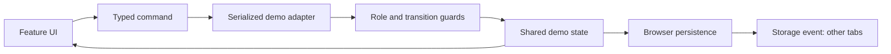

# Kiến trúc frontend ARVESSA

## Một ứng dụng, năm khu vực

Ứng dụng nằm tại `apps/web`, dùng Next.js App Router, React và TypeScript strict. Các route group `(public)`, `(auth)`, `(buyer)`, `(crm)`, `(management)` chia layout và trải nghiệm nhưng cùng dùng domain và nguồn dữ liệu demo. Không có frontend riêng thứ hai, API server nghiệp vụ hay cơ sở dữ liệu.

Root `package.json` chuyển tiếp lệnh bằng `npm --prefix apps/web`. Cách này tránh yêu cầu tạo symlink npm workspace trên Windows; không thay đổi kiến trúc ứng dụng. Dependency và lockfile duy nhất của ứng dụng ở `apps/web`.

## Tầng mã nguồn

| Tầng | Vị trí | Trách nhiệm |
|---|---|---|
| Routes/layouts | `src/app` | URL, metadata, Suspense, error/not-found, ranh giới khu vực |
| Features | `src/features` | Marketing, discovery, spatial, auth, reservation, buyer, CRM, management |
| UI chung | `src/components` | Button, dialog, table, form theo entity, shell, thông báo |
| Domain | `src/domain` | Types, quyền UI, state machine, lọc và định dạng |
| Command contract | `src/services/contracts` | Discriminated union cho lệnh, actor và kết quả |
| Mock adapter | `src/services/mocks` | Seed liên kết, transition guards, phê duyệt, audit |
| Browser store | `src/services/store.ts` | Hydration, persistence, session demo, serialize command, đồng bộ tab |
| Design system | `src/design-system`, `src/app/globals.css` | Tokens và styles responsive |

UI không import fixture trực tiếp. `createSeed()` chỉ phục vụ mock adapter và tests. Component animation không giữ trạng thái nghiệp vụ quan trọng.

## Luồng dữ liệu

Zustand cung cấp snapshot cho React. Mock command có độ trễ nhỏ để thể hiện pending và chống double submit. Lệnh được đưa vào hàng đợi trong tab; Web Locks đồng bộ cập nhật giữa các tab cùng origin khi trình duyệt hỗ trợ. `storage` event cập nhật giao diện tab khác. Không xem những cơ chế này là khóa độc quyền đa người dùng/thiết bị.

## Dữ liệu demo

- The Stillwater: A/B, 6 tầng mỗi tháp, 4 căn mỗi tầng.
- Cedar House: C, 4 tầng, 4 căn mỗi tầng.
- Horizon Bay: D, 5 tầng, 4 căn mỗi tầng; chưa mở đặt cọc demo.
- Tổng ban đầu: 84 căn. Giá, trạng thái, mã căn được dùng chung ở discovery, detail, 3D và workflows.
- Có khách hàng, leads, cơ hội, lịch hẹn, công việc, ticket, chiến dịch và nhân sự khởi tạo. Giữ căn, thanh toán và hợp đồng được tạo từ thao tác thực tế trong demo.
- Policy theo dự án gồm eligibility, số tiền giả lập, thời hạn và nội dung điều khoản. Những con số này không đại diện chính sách pháp lý thật.

## Phân quyền

Chín vai trò: buyer, sales, leader, support, legal, finance, manager, admin, platform. Navigation và route presentation gọi cùng `canModule()`. Command gọi `canWrite()`/`canApprove()` cùng các guard phạm vi. Buyer chỉ thấy hồ sơ của mình; sales lọc leads/cơ hội/khách hàng theo người phụ trách; thông tin liên hệ bị che với một số vai trò.

Mọi dữ liệu vẫn nằm trong bundle/browser demo. Người có DevTools có thể sửa chúng. Backend sau này phải xác thực actor từ session thật, kiểm tra quyền và scope trên từng request; không tin role hoặc buyerId do client gửi.

## Giữ căn và thanh toán

Transition table ở `domain/reservation.ts`. Một số quy tắc quan trọng:

1. Kiểm tra lại căn, giá, eligibility và điều khoản khi gửi hold. Idempotency key có namespace theo actor.
2. Chỉ giữ căn đã xác nhận mới đếm ngược. Các trạng thái hold/payment failed đủ điều kiện hết hạn sẽ mở lại căn.
3. Yêu cầu gia hạn phải được duyệt trước khi hết hạn. Phê duyệt trễ không hồi sinh hold.
4. Payment Submitted khác Payment Confirmed. Kết quả chưa rõ giữ căn ở `PAYMENT_VERIFICATION`, chờ tài chính đối soát; không tự mở lại vì countdown.
5. Chỉ cọc xác nhận mới tạo hợp đồng. Hợp đồng phải có checklist và phê duyệt trước khi ký demo.
6. Hoàn cọc đi qua yêu cầu/phê duyệt; chỉ mở lại căn khi hoàn đã duyệt. Không có tài khoản nhận tiền hay QR thật.

## 3D và tài nguyên

Three.js + OrbitControls được lazy-load ở route explorer. Hình học nguyên bản được dựng từ project/tower/floor/unit. Raycaster thực hiện picking; trạng thái và bộ lọc thay màu/độ mờ của căn. Có chọn bằng bàn phím, chế độ 2D, day/night và fallback nếu WebGL không khởi tạo hoặc mất context.

Renderer, controls, geometry, material, resize observer và animation frame được dọn khi unmount. Pixel ratio giới hạn 1.5. Không tự xoay camera, không scroll hijacking. Asset tĩnh và font phục vụ local, không hotlink.

## Điểm thay thế khi tích hợp API

Thay `services/store.ts` bằng adapter gọi API và giữ các contract command/result làm cơ sở. Server cần bổ sung version/concurrency token, idempotency store, thời gian có thẩm quyền, auth/session, authorization và transaction atomic. Dùng WebSocket/SSE hoặc invalidation query để đồng bộ giá/tình trạng. Payment webhook và reconciliation thuộc server; browser không quyết định xác nhận tiền thật.

Không tái sử dụng fixture, localStorage role, audit phía client hay chính sách demo làm dữ liệu production.

## Tính nhất quán bổ sung

Hoàn cọc đã duyệt hủy các hợp đồng chưa hoàn tất của cùng reservation và đóng yêu cầu phê duyệt hợp đồng đang chờ. Phiên bản hợp đồng đang duyệt/đã ký không được chỉnh sửa; phiên bản cũ được lưu snapshot trước mỗi lần sửa bản nháp. Điều chỉnh cọc demo có approval riêng, cập nhật payment và reservation cùng lúc, kiểm tra lại điều kiện khi duyệt.
